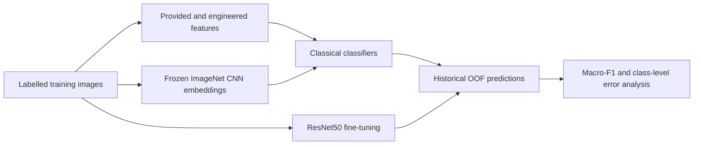
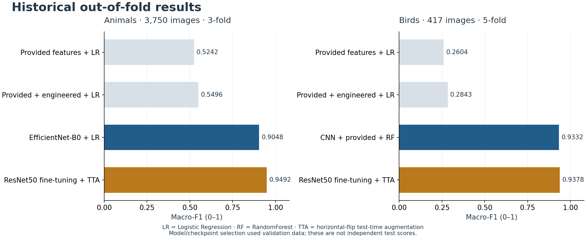

# Small-data image classification

**How far can frozen ImageNet features and classical models go when labelled images are scarce?**

[](https://github.com/tqyyds/small-data-image-classification/actions/workflows/verify.yml)
[Reproduce](docs/reproduction.md) · [Methods](docs/methodology.md) · [Results & errors](docs/results.md) · [Evidence](results/manifest.json)

An independent COMP30027 Machine Learning coursework project by [tqyyds](https://github.com/tqyyds), comparing engineered image descriptors, frozen CNN embeddings and supervised transfer learning on two ten-class tasks. This portfolio edition preserves the original experiments and adds an auditable results trail, CPU checks and reproducibility documentation.

## Problem and approach

| Task | Labelled training images | Unlabelled test images | Classes | Historical validation |
|---|---:|---:|---:|---|
| Animal classification | 3,750 | 1,250 | 10 | 3-fold stratified CV |
| Bird species classification | 417 | 180 | 10 | 5-fold stratified CV |



- **Representation experiments:** provided features, additional colour/edge/texture descriptors, EfficientNet-B0, ResNet50, MobileNetV3-Large, and combined representations.
- **Classical models:** Logistic Regression, linear and RBF SVMs, ExtraTrees and RandomForest, with a majority-class baseline. Imputation, scaling and searched PCA are fitted within sklearn pipelines.
- **Transfer learning:** ImageNet-pretrained ResNet50, frozen-head training followed by backbone fine-tuning, and horizontal-flip test-time augmentation (TTA).

## Core results

**Historical out-of-fold (OOF) macro-F1, recomputed from saved predictions.** These are validation results with model/checkpoint selection limitations, not independent test-set scores.

| Approach | Animals · 3-fold | Birds · 5-fold |
|---|---:|---:|
| Selected frozen-feature model | **0.9048** · EfficientNet-B0 + Logistic Regression | **0.9332** · combined CNN + provided features + RandomForest |
| ResNet50 fine-tuning + TTA | **0.9492** | **0.9378** |



### What I learned

1. **Representation choice mattered more than extra handcrafted descriptors in these runs.** With Logistic Regression held fixed, animal macro-F1 rose from 0.5242 on provided features to 0.9048 on EfficientNet-B0 embeddings; adding handcrafted descriptors to provided features reached 0.5496.
2. **Fine-tuning did not improve every class.** On birds, aggregate macro-F1 was close to the selected frozen-feature model, while gull and warbler errors shifted in different directions. Small validation differences do not establish statistical superiority.
3. **A useful comparison needs an evidence trail.** The repository checks 13 saved prediction sets against classification reports and result tables/JSON, and distinguishes prediction-backed results from summary-only experiments.

See the [class-level analysis and confusion matrices](docs/results.md).

## Run without course data or a GPU

Use Python **3.13**. The commands below do not download model weights or require PyTorch.

```bash
git clone https://github.com/tqyyds/small-data-image-classification.git
cd small-data-image-classification
python -m venv .venv
# Windows PowerShell: .\.venv\Scripts\Activate.ps1
# macOS/Linux: source .venv/bin/activate
python -m pip install -r requirements.txt
python -m unittest discover -s tests -v
python -m src.verify_results
python -m src.synthetic_smoke
```

The smoke run uses temporary, explicitly synthetic images and features. It exercises feature joins, stratified CV, OOF output and prediction CSV generation; its scores are never mixed with historical results.

To regenerate the figures: `python -m src.portfolio_figures`. For original-data experiments, CPU/GPU setup and commands, see [reproduction](docs/reproduction.md) and the [data contract](docs/data.md).

## Evaluation boundaries

- Classical hyperparameters were selected using the same folds later used for OOF evaluation. This is **non-nested CV** and may give optimistic estimates after selection.
- CNN checkpoints were selected on each validation fold and evaluated on that fold. These results also carry selection bias.
- The archive does not establish statistical significance or performance on a new independent dataset. Precomputed course-feature provenance cannot be independently audited here.
- Kaggle feedback recorded only in earlier prose is excluded from the verified claims. Full GPU training was not rerun for this portfolio edition.

See [methodology and limitations](docs/methodology.md) and the [validation record](docs/validation.md).

## Explore the repository

| Area | Contents |
|---|---|
| `src/` | Data checks, feature pipelines, model selection, predictions, evidence verification and figure generation |
| `optional_transfer_cnn/` | Original transfer-learning, CV and ensemble implementations |
| `results/` | Selected figures, untouched historical evidence, manifest and recomputed verification |
| `tests/` | Metadata, join, result-selection and historical-evidence checks |
| `docs/` | Methods, data contract, reproduction, results, validation and resume notes |

The original course data, assignment specification, raw-image figures, checkpoints and temporary submissions are not distributed. Course-provided inputs and ImageNet/torchvision weights retain their respective ownership and terms. No blanket open-source licence is asserted over course materials; see [provenance](docs/provenance.md).
