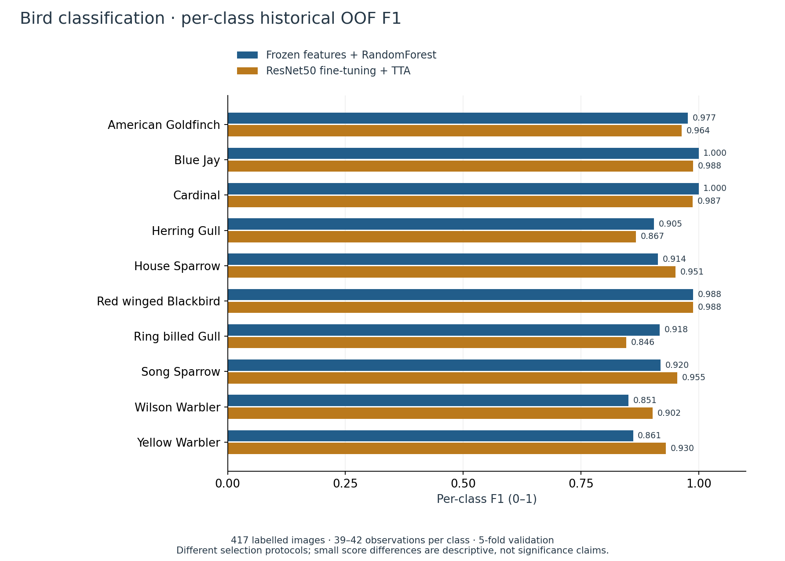
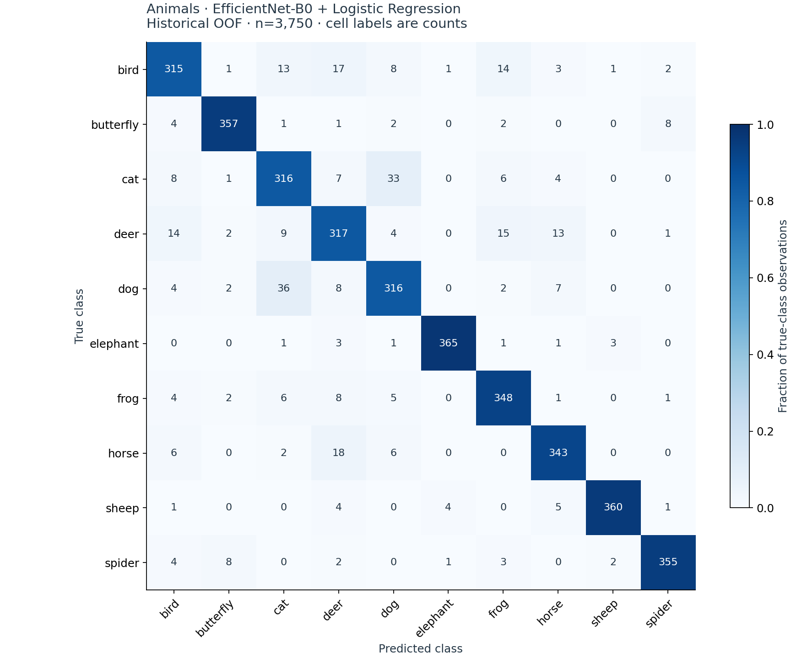
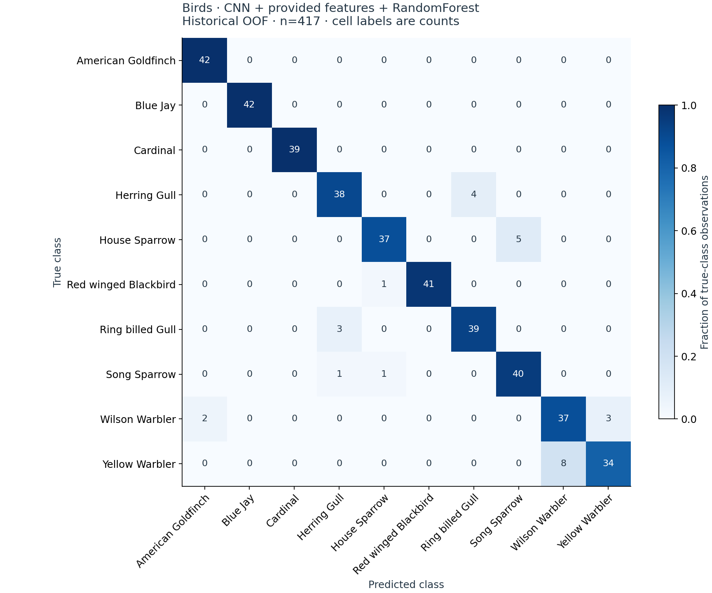

# Results and error analysis

All headline values below are recomputed from saved OOF predictions. The [verification JSON](../results/verification.json) records unrounded metrics; the [manifest](../results/manifest.json) links each experiment to predictions, class reports and historical table rows. These are historical validation results with the [selection limitations](methodology.md).

## Representation and model comparisons

The animal task shows a large descriptive gap between Logistic Regression on provided features (0.5242 macro-F1) and on frozen EfficientNet-B0 features (0.9048). Adding engineered descriptors to provided features reaches 0.5496. Fine-tuned ResNet50 + TTA reaches 0.9492 under validation-based checkpoint selection.

For birds, provided-feature Logistic Regression reaches 0.2604 and provided-plus-engineered features reach 0.2843. The selected combined-feature RandomForest reaches 0.9332, while fine-tuned ResNet50 + TTA reaches 0.9378. The latter comparison changes both representation/training and classifier, so it is not a controlled estimate of a single intervention. The small aggregate difference does not establish superiority on new data.

The four headline models are selected representatives, not a claim that every chosen configuration is the maximum in every archived table. The [full classical comparison](../results/model_comparison.csv) preserves all 29 distinct historical rows and marks each row `prediction_verified` or `summary_only`. Some configurations share outputs across execution modes; their rows remain separate because mode and other metadata differ. No unequal rows were silently merged. Mean CV macro-F1 and pooled OOF macro-F1 remain separate fields.

## Class-level behaviour

The saved bird predictions show different tradeoffs beneath similar aggregate scores. Relative to RandomForest, fine-tuning raises Yellow Warbler and Wilson Warbler F1 while reducing Herring Gull and Ring-billed Gull F1. The RandomForest's lowest per-class F1 values are Wilson Warbler (0.851) and Yellow Warbler (0.861). There are only 39–42 observations per class, so a few errors can materially change a class score. Exact precision, recall, F1 and support are in the [class-level CSV](../results/bird_per_class.csv).

These observations motivate collecting more representative examples for weak classes and testing on an independent split. They do not prove a visual cause of error: source images are not redistributed or inspected in this portfolio validation.

## Confusion matrices

Cell labels are counts; colour is the fraction of the true class predicted into that column. Both matrices use the same 0–1 colour scale.

### Animals: EfficientNet-B0 + Logistic Regression

### Birds: combined CNN + provided features + RandomForest

The original archive also contained raw-image misclassification montages. They are excluded from this repository; the class counts and matrices provide inspectable error evidence without distributing the underlying images.
